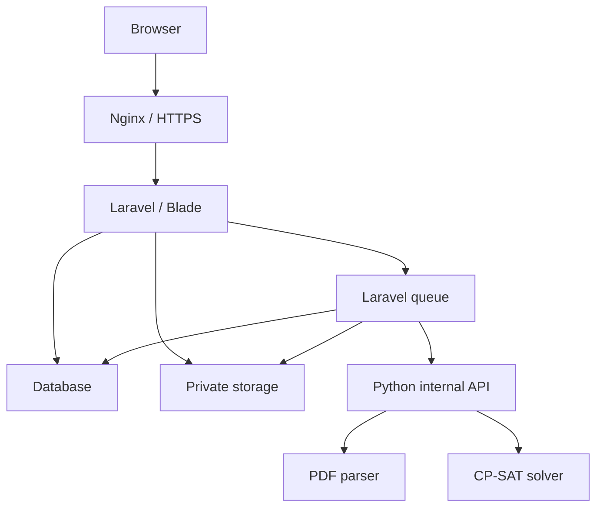

# Arsitektur — Sistem Supervisi Mutu Perkuliahan

Versi **2.0** · 22 September 2026 · Aturan bisnis: `PRD.md` · Kontrak data: `schema.md`.

## 1. Keputusan inti

Laravel adalah aplikasi utama dan satu-satunya pemilik write database. Python hanya menangani parsing PDF dan constraint scheduling. Gunakan modular monolith, bukan memecah semua modul menjadi microservice.

| Lapisan | Baseline |
|---|---|
| Backend | PHP kompatibel Laravel 13, minimum framework PHP 8.3; Laravel 13.x |
| Auth/RBAC | Session auth Laravel, Spatie Laravel Permission, resource policies |
| UI | Blade, Vite, Tailwind CSS 4.x, Alpine.js 3.x, collapse, Lucide, SweetAlert2 |
| Grafik | Chart.js sebagai pilihan tunggal awal; tidak memasang Chart.js dan ApexCharts sekaligus |
| Database | MySQL 8.4 InnoDB; MariaDB hanya bila existing memerlukan dan diuji |
| Queue | Laravel database queue untuk baseline; Redis opsional sesuai kebutuhan terukur |
| File | Laravel Filesystem disk private local; S3-compatible melalui adapter jika dibutuhkan |
| PDF | barryvdh/laravel-dompdf; adapter renderer agar dapat diganti jika hasil uji layout gagal |
| Excel P1 | Maatwebsite Excel versi kompatibel yang dibuktikan Composer |
| Python | Python 3.12 sebagai target awal, FastAPI, Pydantic, PyMuPDF/pdfplumber, OR-Tools CP-SAT |
| Operasi | Nginx, PHP-FPM, process supervisor/systemd untuk queue dan Python |

Ini target implementasi, bukan janji semua kombinasi paket sudah diuji. Agent wajib memeriksa Composer constraints, `engines` Vite/Node dan wheel Python pada OS/arsitektur sasaran, kemudian mengunci versi melalui `composer.lock`, lock npm dan lock dependency Python. Jangan memakai `--ignore-platform-reqs`, paket dev branch, atau mengganti framework diam-diam untuk melewati konflik.

Laravel 13 minimum PHP 8.3 dikonfirmasi dari dokumentasi resmi pada tanggal revisi. Tailwind 4 memakai integrasi Vite resmi; jangan menyalin langkah `tailwindcss init -p` dari tutorial Tailwind 3. Kompatibilitas package pihak ketiga tetap harus diuji pada rilis yang benar-benar dipasang.

## 2. Topologi dan batas tanggung jawab



- Browser tidak menghubungi Python langsung dan tidak menerima internal service token.
- Python menerima file byte/payload tervalidasi dan mengembalikan data; tidak memiliki kredensial database utama.
- Web server hanya menyajikan Laravel `public/`. Directory private dan PDF input tidak dipublikasikan melalui symlink storage.
- Request web memulai job, lalu UI memantau status. Pekerjaan berat tidak dijalankan dalam request pengguna biasa.
- Production di Ubuntu; development dapat memakai Laragon+venv atau Docker Compose. Pilih satu jalur dev yang benar-benar diverifikasi. Jangan memaksa Docker jika repository existing sudah mempunyai lingkungan valid.

## 3. Modul aplikasi

| Modul | Komponen utama | Batas |
|---|---|---|
| Identity | AccountService, policies, role/permission | Tidak membuat identitas dosen tebakan |
| Academic | term, master, calendars, occurrence generator | Memiliki definisi waktu dan afiliasi kelas |
| Import | validation, parser client, row review, commit | Staging dahulu; commit atomik |
| Scheduling | CandidateBuilder, ConflictChecker, solver client, ApplyRunService | Proposal terpisah dari apply |
| Instruments | TemplatePublisher, ConditionEvaluator, stage bindings | Versi published immutable |
| Supervision | DraftService, EvidenceService, SubmitService | Ownership dan optimistic version |
| Scoring | strategy registry dan calculator | Angka hanya dihitung server |
| Analytics | scoped queries dan paired comparison | Satu definisi metrik untuk UI dan export |
| Reporting | schedule PDF dan report renderer | Snapshot, revision dan private download |
| Operations | audit, idempotency, jobs, health | Tidak mengekspos token atau bukti |

Controller tipis, validasi input pada FormRequest, keputusan bisnis di service/action, policy pada setiap resource. Blade merender view model; tidak menghitung solver, skor atau otorisasi.

Lokasi usulan: `app/Services/{ScheduleImport,Scheduling,Instruments,Supervision,Scoring,Analytics,Reporting}`, `app/Policies`, `app/Jobs`, `app/Enums`, `app/Contracts`, `python-service/app/{api,parsers,scheduler,contracts}`, `tests/fixtures`. Sesuaikan struktur existing tanpa rewrite yang tidak diperlukan.

## 4. Model waktu dan sumber kebenaran

- Laravel menghasilkan occurrence bertanggal dari weekly teaching_schedules, date range, kalender dan exception.
- Gunakan ISO weekday 1–7 dan timezone term. Simpan interval UTC serta tanggal lokal; semua perbandingan memakai interval yang sama.
- Overlap tanpa buffer: `a.start < b.end AND b.start < a.end`.
- Dengan gap minimum `b` menit, dua aktivitas valid jika `endA + b <= startB` atau sebaliknya. Jangan menambahkan buffer pada kedua ujung sehingga gap efektif menjadi 2b.
- Kendala buffer hanya diterapkan pada pasangan yang melibatkan supervisi; dua teaching_busy_intervals existing tidak dibuat infeasible hanya karena jarak antarkuliahnya kurang dari buffer.
- Jadwal semua dosen yang relevan, semua penugasan DRAFT/FINAL aktif lintas periode, dan locked assignment masuk snapshot. Jangan hanya memeriksa tahap yang sedang di-generate.
- Snapshot identity pada assignment/form/PDF menjaga histori ketika nama master berubah. Data aktif untuk penjadwalan tetap revalidated, bukan dibenarkan hanya karena snapshot lama menyatakan VALID.

## 5. Import PDF dan kontrak parser

### Pipeline

1. Validasi ukuran, MIME dan isi PDF; simpan file privat dengan hash.
2. Buat `schedule_imports`; dispatch `ParseSchedulePdfJob` setelah commit transaksi.
3. Laravel mengirim multipart file bytes dan metadata ke Python. Python tidak menerima URL/path arbitrary untuk diunduh/dibaca.
4. Adapter mencoba text extraction/layout. Jika tidak memadai, kembalikan issue terstruktur.
5. Laravel memvalidasi response Pydantic/OpenAPI contract, menyimpan staging rows dan menampilkan review.
6. LPM memperbaiki field, memilih identity, menyetujui atau melewati baris beralasan.
7. Commit satu file atomik; validasi row_version dan jadwal terdampak, upsert yang sudah dipetakan, generate occurrence dan audit. Beberapa file diproses terpisah dengan hasil sukses/gagal per file.

### API internal v1

`POST /v1/parse-schedule`, multipart `file`, `metadata` JSON; header `Authorization: Bearer <internal token>` dan `X-Request-ID`. Metadata mempunyai contract_version, import_id, term_id, timezone, semester dan tahun akademik konteks yang dipilih LPM.

Contoh response sintetis, bukan data institusi:

```json
{
  "contract_version": "1.0",
  "request_id": "c1d4c6f0-1234-4567-8910-111111111111",
  "import_id": 10,
  "parser": {"name": "tabular-layout-a", "version": "1.0.0"},
  "page_count": 1,
  "issues": [],
  "rows": [
    {
      "row_no": 1,
      "source": {"page": 1, "bbox": [40, 120, 790, 160]},
      "raw": {"lecturer_text": "Dosen Contoh", "time_text": "09.00-10.40"},
      "normalized": {
        "lecturer_name": "Dosen Contoh",
        "lecturer_external_code": null,
        "faculty_name": "Fakultas Contoh",
        "study_program_name": "Program Studi Contoh",
        "semester": "GENAP",
        "academic_year": "2026/2027",
        "day_of_week": 1,
        "start_time": "09:00",
        "end_time": "10:40",
        "class_name": "Kelas A",
        "course_name": "Mata Kuliah Contoh",
        "course_code": null,
        "room_name": "R. 302",
        "delivery_mode": "OFFLINE"
      },
      "confidence": 0.88,
      "issues": []
    }
  ]
}
```

Confidence null diperbolehkan jika adapter tidak mempunyai estimasi yang bermakna. Setiap issue memuat `code`, `severity`, `row_no?`, `field?`, `message`, `suggested_action?`. Code minimal PDF_INVALID, PDF_ENCRYPTED, OCR_REQUIRED, UNSUPPORTED_LAYOUT, MISSING_FIELD, AMBIGUOUS_LECTURER, INVALID_TIME dan DUPLICATE_CANDIDATE.

Error kontrak bukan kebutuhan review data: HTTP 422 untuk request invalid, 413 ukuran berlebih, 401 auth, 500/503 kegagalan layanan. PDF yang bisa dibaca tetapi berisi field tidak lengkap dapat HTTP 200 + issues. Output kosong tidak boleh menjadi import READY otomatis.

Batas teknis awal configurable: 20 MiB/file, 10 file/batch, 100 halaman/file, timeout parser 120 detik. Selaraskan Nginx/PHP/app/Python agar batas konsisten. Parser bekerja pada temporary directory terisolasi dengan cleanup; teks PDF tidak pernah dianggap instruksi agent/command.

## 6. Kontrak scheduler dan aturan

`POST /v1/solve-assignments`, JSON, autentikasi internal dan request ID yang sama.

Input wajib:

| Field | Isi |
|---|---|
| `contract_version`, `request_id`, `input_revision`, `input_hash` | Versi kontrak dan snapshot yang akan diperiksa saat apply |
| `period_id`, `stage_id`, `stage_no`, `timezone`, `date_range` | Cakupan penjadwalan |
| `rules` | Snapshot immutable scheduling_rules + version |
| `targets`, `supervisors` | ID, afiliasi tervalidasi dan keanggotaan |
| `occurrences` | ID, target, tanggal lokal, UTC start/end, kelas/mode/unit |
| `teaching_busy_intervals` | Seluruh aktivitas mengajar supervisor yang relevan, juga untuk menghitung jumlah per hari |
| `reserved_supervisions` | DRAFT/FINAL lintas tahap/periode yang tidak boleh dilanggar |
| `locked_assignments` | Seluruh manual/locked/final yang harus tetap |
| `previous_auto_assignments` | Usulan yang boleh diganti, untuk minimisasi perubahan |
| `prior_stage_assignments` | Pasangan target T1 untuk tanggal/gap/kebijakan T2 |
| `solver_options` | Time limit, seed, workers dan strategy objective |

Semua interval dikirim ISO-8601 UTC. Rule numerik berupa integer; CP-SAT memakai menit integer relatif terhadap origin snapshot, bukan floating point tanggal.

Pisahkan set input berdasarkan ID: AUTO DRAFT mutable pada tahap yang sedang disusun hanya masuk previous_auto_assignments, bukan reserved_supervisions tetap. Locked/final di tahap itu masuk locked_assignments satu kali; assignment luar tahap masuk reservasi tetap. Jangan memasukkan penugasan yang sama dua kali sebagai dua aktivitas atau membekukan semua AUTO sehingga recalc tidak dapat bergerak.

Konfigurasi demo lengkap:

```json
{
  "schema_version": "1.0",
  "block_supervision_when_teaching_count_gte": 3,
  "buffer_minutes": 0,
  "max_supervisions_per_day": null,
  "max_supervisions_per_week": null,
  "max_daily_span_minutes": null,
  "cross_unit_policy": "ANY",
  "stage_supervisor_policy": "ANY",
  "min_stage_gap_days": 0,
  "one_observation_per_target_per_stage": true,
  "require_t2_after_t1": true
}
```

Tidak mengirim status APPROVED palsu untuk konfigurasi demo. T2 hanya mempunyai kandidat apabila T1 target sudah mempunyai assignment aktif bertanggal; T1 tidak harus submitted untuk penjadwalan T2.

### Pemodelan minimum

- Variabel biner `x[target, supervisor, occurrence]` hanya pada kandidat yang lolos prafilter.
- Untuk target belum locked: jumlah pilihan `<=1`. Target locked tepat satu pilihan fixed.
- Kendala pasangan/NoOverlap menolak aktivitas tumpang tindih; teaching tidak menjadi variabel yang boleh dipindah.
- Pertemuan target memerlukan kelas yang valid; hari dengan jumlah mengajar >=3 tidak mempunyai kandidat supervisi.
- Hitung batas harian/mingguan dan span memakai mengajar + seluruh reservasi tetap + pilihan baru. Reservasi luar tahap tidak boleh diubah.
- Objective bertingkat coverage → balance → sedikit perubahan. Gunakan penyelesaian bertahap atau bobot dengan batas dominasi yang dibuktikan; jangan memakai angka bobot arbitrer yang dapat mengorbankan coverage.
- Jika tahap optimasi awal hanya FEASIBLE, catat bahwa optimum coverage belum terbukti. Simpan solusi terbaik valid, bukan mengklaim optimal.
- Time budget total 60 detik awal, bukan 60 detik per setiap tingkat tanpa batas keseluruhan. Simpan parameter, runtime dan versi solver untuk reproduksi.

Contoh response sintetis parsial:

```json
{
  "contract_version": "1.0",
  "request_id": "c1d4c6f0-1234-4567-8910-222222222222",
  "input_revision": 42,
  "input_hash": "aaaaaaaaaaaaaaaaaaaaaaaaaaaaaaaaaaaaaaaaaaaaaaaaaaaaaaaaaaaaaaaa",
  "solver_status": "FEASIBLE",
  "coverage_status": "PARTIAL",
  "assignments": [
    {"target_id": 101, "supervisor_id": 202, "occurrence_id": 7001}
  ],
  "unassigned": [
    {"target_id": 102, "reason_codes": ["NO_FREE_SUPERVISOR"], "diagnostic_kind": "PREFILTER"}
  ],
  "diagnostics": {"target_count": 2, "assigned_count": 1, "wall_time_ms": 1050, "optimality_proven": false}
}
```

Laravel mengambil interval dari occurrence ID dan memvalidasi ulang; tidak mempercayai supervisor/target arbitrary dari response.

### Arti status solver

| Status | Perlakuan |
|---|---|
| OPTIMAL | Ada solusi dan objective yang dilaporkan terbukti optimal |
| FEASIBLE | Ada solusi valid; optimum belum terbukti |
| INFEASIBLE | Model terbukti tidak memiliki solusi; tampilkan diagnosis yang tersedia |
| UNKNOWN | Belum menemukan/membuktikan hasil sebelum limit; tidak boleh disebut mustahil |
| MODEL_INVALID | Bug/model tidak valid; gagal teknis, bukan kesalahan jadwal pengguna |

Karena coverage parsial diperbolehkan, target tanpa kandidat tidak otomatis menyebabkan INFEASIBLE; model dapat feasible dengan nol/parsial. Konflik locked atau model hard constraint lain dapat menyebabkan INFEASIBLE. Alasan dari prafilter disebut diagnosis; jangan mengklaim minimal unsat core jika fitur itu tidak diimplementasikan.

## 7. Transaksi, race condition dan idempotency

Global row `scheduling_state` memberikan revision dan lock seluruh perubahan reservasi pada P0. Ini keputusan sederhana untuk menjaga konflik lintas periode, bukan hanya lock per stage.

### Generate dan apply

1. Ambil snapshot konsisten beserta revision/hash dengan transaksi baca singkat.
2. Lepas lock/transaksi sebelum solver berjalan. Simpan schedule_run.
3. Solver selesai; Laravel memvalidasi bentuk response dan menyimpan proposal.
4. Saat apply: lock global row, stage dan assignment secara berurutan. Cocokkan revision snapshot dengan revision terkini.
5. Jika berbeda, tandai STALE; jadwal existing tetap utuh. Generate ulang dari data baru.
6. Jika sama, validasi seluruh hasil dan manual lock ulang; cancel AUTO lama yang memang diganti, insert/update proposal, audit, naikkan global revision dan tandai APPLIED dalam satu transaksi.

Jangan hapus semua assignment di awal generate. Hasil parsial yang akan menggugurkan AUTO lama ditampilkan dalam preview sebelum apply. Manual displacement dan audit atomik; job recalc didispatch setelah commit. Job gagal tidak membatalkan manual yang sudah valid.

`input_revision` yang tersimpan pada assignment adalah provenance, bukan syarat bahwa semua assignment harus selalu sama dengan revision global terbaru. Equality gate berlaku ketika menerapkan **proposal yang belum dipakai**. Setelah apply menaikkan revision, assignment tetap valid sampai perubahan relevan memerlukannya diperiksa ulang; finalisasi selalu memakai ConflictChecker pada keadaan terkini.

Perubahan rules membuat assignment DRAFT terdampak NEEDS_RECALCULATION. Manual lock tetap; setelah LPM meninjau dan validator membuktikan slotnya valid terhadap rules baru, catat audit validasi dan versi rule yang dipakai tanpa memindahkannya otomatis. Jika invalid, finalisasi tertahan sampai perubahan manual sah. Rules baru tidak diterapkan retrospektif pada FINAL.

Finalisasi T2 memeriksa T1 pasangan sudah FINAL. Reopen T1 ditolak selama T2 dependent masih FINAL. Saat reopen yang sah, form ASSIGNED tanpa jawaban tetap tidak editable; snapshot/binding-nya diperbarui secara atomik saat finalisasi ulang. Assignment yang dibatalkan beserta form ASSIGNED lamanya hanya menjadi histori dan tidak masuk tugas aktif. DRAFT/SUBMITTED tidak di-reset.

### Idempotency dan version

- Endpoint commit, generate request, apply, finalize dan submit memakai `Idempotency-Key` + hash payload + user/operation scope.
- Key sama/payload sama mengembalikan resource lama; payload berbeda menghasilkan HTTP 409.
- PATCH review/draft/override membawa row_version. Jika stale, server 409 mengembalikan versi baru dan UI membantu reload/review; jangan last-write-wins diam-diam.
- Dispatch queue `afterCommit`. Unique job dapat mengurangi duplikasi, tetapi constraint/idempotency database tetap wajib.
- Bukti/score/assignment tidak dihitung hanya berdasarkan parameter request. Query ownership dan kondisi bisnis selalu diulang di server.

## 8. Form engine, conditional fields dan submit

Template publisher memeriksa sumber, jumlah soal, urutan, mode, pilihan, required field, validasi conditional graph dan policy binding. Draft template dapat diedit; published immutable.

Contoh struktur kondisi **sintetis**, bukan aturan bahasa Inggris resmi:

```json
{
  "all": [
    {"question_code": "DEMO_YES_NO", "operator": "eq", "value": "YES"}
  ]
}
```

Implement operator allowlist (`eq`, `neq`, `in`) dan `all/any`; field konteks yang diizinkan antara lain study_program_id dan delivery_mode. UI dan server memakai semantics sama melalui fixture kontrak, server tetap otoritatif. Unknown reference/cycle ditolak saat publish. Required dievaluasi setelah applicability.

Draft menyimpan perubahan partial dan menaikkan row_version. Autosave debounce sekitar 1 detik, single-flight per tab, antrekan perubahan lokal di memory. Hindari menyimpan data penilaian/bukti permanen di localStorage. Arahkan pengguna menyimpan sebelum keluar jika request belum terkonfirmasi.

Submit: lock → authorize → periksa stage/period → evaluasi kondisi → validasi required/opsi/evidence READY → hitung score dari pilihan resmi → snapshot → update SUBMITTED → audit → commit. Jika error, tidak ada hasil setengah submitted. Klik ulang mengembalikan hasil yang sama.

## 9. Scoring dan analitik

`ScoringService` menerima template/policy immutable dan jawaban tervalidasi. Strategy registry mendukung tiga formula PRD; tidak menerima script formula dari UI. Gunakan arithmetic decimal yang sesuai presisi, bukan akumulasi floating point yang dibulatkan tiap item.

Output: raw_score, scored_question_count, final_score, template_id/version, policy_id/code/version, evidence references dan snapshot hash. Nilai hanya persisted resmi saat submit. Preview draft diberi label estimasi.

Analytics menggunakan query scoped periode/tahap/unit dan submitted results; eager loading/index menghindari N+1. Perubahan rata-rata memakai inner join pasangan lecturer_id/period_id yang comparable. Rerata per tahap dengan missingness berbeda tidak boleh dipakai sebagai paired delta. Cache (jika ada) di-key oleh periode, filter, template/policy dan revision submission; invalidasi setelah commit.

## 10. PDF dan file evidence

- Render schedule PDF dari view model yang sama dengan Jadwal Saya, dipaginasi per minggu dan disnapshot revisinya.
- Awal A4 landscape; font yang di-embed mendukung teks Indonesia, nama panjang dan glyph yang dipakai. Hindari mengambil font/asset dari URL acak saat generate.
- DomPDF menggunakan view cetak berbasis tabel/print CSS. Jika clipping tidak dapat diperbaiki, uji adapter Chromium dan catat alasan/dependency; jangan mengganti tanpa bukti layout.
- Nonaktifkan remote resource fetching untuk renderer kecuali allowlist yang benar-benar diperlukan. Teks pengguna di-escape dan tidak menjadi HTML executable.
- File evidence: allowlist JPEG/PNG/WebP awal, 10 MiB/file dan maksimal 5 gambar/pertanyaan sebagai default configurable yang harus mengikuti sumber resmi. Decode/re-encode gambar, batas dimensi 20 megapiksel awal, nama UUID, validasi MIME asli, ekstensi dan ukuran. Tolak SVG/executable.
- LINK hanya URL http/https tervalidasi, tidak di-fetch server otomatis. Link membuka tab baru dengan atribut keamanan. Jika akses link eksternal memerlukan izin, UI menyebut belum diverifikasi, bukan mengklaim bukti pasti dapat dibuka.
- Unduhan melalui controller yang memeriksa policy atau signed URL berumur pendek setelah authorization. Tebakan URL/ID tidak memberikan akses.
- Stale PDF dihasilkan ulang saat revisi berubah; file sementara dan orphan dibersihkan terjadwal. Jangan menghapus evidence submitted dalam cleanup.

## 11. Endpoint aplikasi minimum

Route berikut adalah kontrak kemampuan; nama kelas controller dapat menyesuaikan proyek:

| Endpoint | Perilaku |
|---|---|
| `POST /lpm/imports` | Upload → 202/resource import |
| `GET /lpm/imports/{id}` | Status, hasil dan issue sesuai hak akses |
| `PATCH /lpm/import-rows/{id}` | Review dengan row_version |
| `POST /lpm/imports/{id}/commit` | Validasi dan commit idempotent |
| `PUT /lpm/periods/{id}/supervisors` | Pilihan dosen per periode, audit perubahan |
| `PUT /lpm/periods/{id}/targets` | Scope INCLUDED/EXCLUDED dan alasan |
| `POST /lpm/stages/{id}/runs` | Enqueue solver, 202 |
| `GET /lpm/runs/{id}` | Status dan proposal |
| `POST /lpm/runs/{id}/apply` | Apply snapshot terkini, 409 jika stale |
| `PATCH /lpm/assignments/{id}` | Manual override + reason/version |
| `POST /lpm/stages/{id}/finalize` | Gate lalu publikasi tugas |
| `POST /lpm/stages/{id}/reopen` | Reason + prasyarat PRD |
| `PUT /supervisor/supervisions/{id}/draft` | Simpan partial, 409 jika konflik edit |
| `POST /supervisor/supervisions/{id}/evidence` | Validasi dan simpan privat |
| `POST /supervisor/supervisions/{id}/submit` | Submit atomik dan idempotent |
| `POST /schedule-documents` | Request PDF sesuai ownership |
| `GET /documents/{id}/download` | Authorize lagi sebelum byte terkirim |

Tambahkan CRUD term/period/master/template/policy, login/logout/profile, dashboard dan detail hasil sesuai PRD. Semua endpoint mutation menerapkan CSRF sesi. Error JSON konsisten: `code`, `message`, `field_errors?`, `conflicts?`, `request_id`; tidak menampilkan stack trace/SQL/token.

## 12. Queue dan reliabilitas

Job: ParseSchedulePdfJob, GenerateAssignmentsJob, RecalculateAssignmentsJob, GenerateSupervisorSchedulePdfJob; P1 GenerateReportPdfJob/GenerateExcelReportJob. Queue terpisah `imports`, `scheduling`, `documents` bila diperlukan untuk menjaga responsivitas.

Default operasional awal: solver limit 60 s, HTTP solver timeout 75 s, job solver 100 s; parser HTTP timeout 120 s dan job parser 150 s; PDF job 120 s. Worker timeout maksimum 180 s, database queue retry_after 240 s. Pastikan seluruh timeout job/worker lebih kecil dari retry_after, dan hard limit proses Python benar-benar diberlakukan.

Retry maksimal 3 dengan backoff (misalnya 10/30/60 s) hanya untuk kegagalan transient. Request invalid, konflik domain, MODEL_INVALID dan input stale tidak diulang otomatis tanpa perubahan input. Job final gagal menulis code/pesan yang dapat ditindaklanjuti. Poll UI memakai jeda/backoff, berhenti pada terminal status; progres menunjukkan fase yang diketahui, bukan persentase rekaan.

## 13. Keamanan dan operasi production

- Password hashing Laravel, session cookie HttpOnly/Secure/SameSite, rotate session sesudah login, revoke ketika akun dinonaktifkan, rate limit login/reset.
- Query memfilter ownership/period, tidak hanya memeriksa role. Uji IDOR pada form, evidence, job result, PDF dan dashboard.
- Internal Python bind private/loopback, bearer token dari secret environment, request size limits, timeout dan log sanitization. Dokumentasi API internal tidak diekspos publik.
- Input PDF/teks/URL dianggap data tidak tepercaya; tidak dijalankan sebagai shell, HTML, SQL atau instruksi sistem.
- Environment contoh memuat nama konfigurasi dan placeholder, tanpa credential nyata. `APP_DEBUG=false` di production.
- Logging terstruktur dengan request_id, import/run/stage ID, durasi, error_code; jangan log jawaban/bukti lengkap secara default.
- Health liveness mengecek proses; readiness mengecek database, storage writable dan dependensi yang diperlukan. Proses queue mati harus terlihat melalui monitoring/log/health operasional.
- Backup DB, private files dan kunci konfigurasi yang diperlukan; simpan terenkripsi di lokasi terpisah, jadwal/retensi dikonfigurasi operator. Lakukan restore drill pada lingkungan terpisah sebelum rilis.
- Deployment: backup → pasang release dengan lockfile → build assets → migration non-destruktif → cache config/routes/views → restart worker/Python → smoke test → catat versi. Rollback memakai release sebelumnya; schema rollback yang menghapus data tidak dilakukan otomatis.
- Publishing ke server produksi memerlukan target dan otorisasi deploy. Ketiadaan server/secret tidak mencegah penyiapan runbook dan paket lokal yang lengkap.

## 14. Pengujian dan observabilitas

PHP unit/feature: policies, import commit, identity matching, temporal conflict checker, conditional fields, score, idempotency, stale version dan analytic queries. Integration menggunakan MySQL target untuk lock/generated unique key; SQLite saja tidak membuktikan integritas MySQL.

Python pytest: minimal dua fixture layout, malformed/no-text/missing fields, solver hard constraints, locked conflict, feasible partial dan UNKNOWN. Contract test memeriksa Pydantic schema dan client Laravel dengan fixture payload bersama.

E2E: unggah → review → scope/supervisor → generate/apply → manual override → finalisasi → PDF → isi dua mode → submit T1/T2 → perbandingan. Periksa UI desktop/mobile dan PDF hasil render nyata. Rincian serta gate ada di `MVP.md`.

## 15. Referensi teknis primer

Diperiksa 22 September 2026; gunakan lagi saat mengunci dependency proyek. Referensi ini memvalidasi perilaku alat, bukan kebijakan akademik LPM.

- [Laravel 13 release notes: PHP dan versi framework](https://laravel.com/docs/13.x/releases).
- [Tailwind CSS: integrasi Laravel dan Vite](https://tailwindcss.com/docs/installation/framework-guides/laravel/vite).
- [Google OR-Tools CP-SAT: integer constraints dan status solver](https://developers.google.com/optimization/cp/cp_solver).
- [Laravel DomPDF: manifest dependency maintainer](https://github.com/barryvdh/laravel-dompdf/blob/master/composer.json). Manifest branch bukan bukti bahwa setiap tag rilis memiliki dependency identik; verifikasi tag yang dipasang.

Versi pasti Spatie, Excel, Vite/Node dan paket Python belum disertifikasi oleh dokumen ini. Agent harus mencatat hasil resolusi aktual, bukan mengubah ketidakpastian menjadi klaim kompatibilitas.
