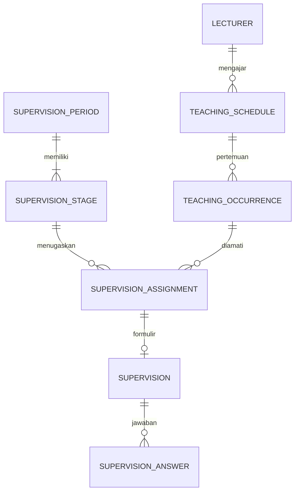

# Schema — Sistem Supervisi Mutu Perkuliahan

Versi **2.0** · 22 September 2026 · Pasangan dokumen: `PRD.md`, `Arsitektur.md`, `Desain.md`, `MVP.md`.

## 1. Konvensi dan target database

Baseline implementasi baru: **MySQL 8.4 / InnoDB**, `utf8mb4`. MariaDB hanya digunakan apabila lingkungan existing memerlukannya dan migrasi, constraint serta uji concurrency dijalankan pada versi yang dipilih. Jangan mengklaim kompatibilitas kedua engine hanya karena SQL terlihat serupa.

- `id`: `BIGINT UNSIGNED` PK auto-increment, kecuali disebut lain. FK menggunakan tipe identik.
- `timestamps`: `created_at`, `updated_at` UTC (`DATETIME(6)`); event immutable hanya `created_at`.
- `?` = nullable; lainnya NOT NULL. String default `VARCHAR(255)`; status/kode `VARCHAR(40)` dengan enum PHP dan DB CHECK pada engine terpilih.
- Semua status mengikuti PRD §12. JSON mempunyai validator skema di application layer; bukan penampung data tanpa kontrak.
- `row_version`: integer unsigned default 1 untuk optimistic concurrency. Setiap perubahan entity terkait menaikkannya.
- Waktu occurrence/assignment adalah UTC; tanggal lokal memakai kolom DATE. Jam pola mingguan bertipe TIME lokal.
- PK/FK, unique dan index dibuat dalam migration. CHECK tidak menggantikan validasi lintas tabel dalam transaksi.
- FK historis memakai `RESTRICT`. Jangan cascade-delete dosen, jadwal, formulir, assignment atau bukti yang sudah menjadi rekam supervisi. Master dinonaktifkan, bukan dihapus fisik.
- Nilai enum diserialisasi konsisten uppercase kecuali nama role Spatie lowercase.

## 2. Hubungan inti



Diagram hanya relasi alur inti. FK lengkap berada di definisi tabel berikut.

## 3. Identitas dan akademik

### 3.1 `users`

`id`, `lecturer_id? FK lecturers`, `name`, `email`, `password`, `is_active BOOLEAN DEFAULT true`, `must_change_password BOOLEAN DEFAULT true`, `remember_token?`, `last_login_at?`, `timestamps`.

Unique: email yang dinormalisasi lowercase; `lecturer_id` nullable unique sehingga satu dosen maksimal satu akun. Superadmin boleh tanpa lecturer. User dengan role supervisor wajib mempunyai lecturer melalui validasi aplikasi. Kolom password adalah hash; tidak menyimpan password sementara mentah.

Tabel Spatie `roles`, `permissions`, `model_has_roles`, `model_has_permissions`, `role_has_permissions` mengikuti migration package yang dipasang. Role bukan pengganti pemeriksaan `period_supervisors` dan ownership. Sertakan tabel session/reset token sesuai autentikasi yang diimplementasikan.

### 3.2 `faculties`

`id`, `code VARCHAR(40) UNIQUE`, `name`, `is_active BOOLEAN DEFAULT true`, `timestamps`.

### 3.3 `study_programs`

`id`, `faculty_id FK faculties`, `code VARCHAR(40)`, `name`, `is_active BOOLEAN DEFAULT true`, `timestamps`.

Unique `(faculty_id, code)`; index `(faculty_id, is_active)`. Kode internal yang dibuat LPM harus ditandai sebagai kode internal, tidak diklaim berasal dari PDF.

### 3.4 `lecturers`

`id`, `faculty_id? FK faculties`, `study_program_id? FK study_programs`, `external_code? VARCHAR(100) UNIQUE`, `name`, `normalized_name`, `is_active BOOLEAN DEFAULT true`, `row_version`, `timestamps`.

Index `(normalized_name)`, `(study_program_id, is_active)`. `normalized_name` **tidak unique**. Jika study_program diisi, faculty harus cocok dengan induk prodi. Afiliasi nullable memerlukan review sebelum dipakai dalam rule lintas unit; tidak otomatis diisi dari salah satu kelas yang diajar.

### 3.5 `academic_terms`

`id`, `semester VARCHAR(10)`, `academic_year VARCHAR(9)`, `starts_on DATE`, `ends_on DATE`, `timezone VARCHAR(64) DEFAULT 'Asia/Jakarta'`, `row_version`, `timestamps`.

Unique `(semester, academic_year)`; CHECK semester GANJIL/GENAP dan `starts_on <= ends_on`; validasi tahun seperti `2026/2027`. Timezone harus nama IANA yang didukung. Tidak boleh mengubah timezone setelah memiliki occurrence/assignment tanpa migrasi terkontrol.

### 3.6 `courses`

`id`, `code? VARCHAR(100) UNIQUE`, `name`, `normalized_name`, `is_active BOOLEAN DEFAULT true`, `timestamps`.

Index normalized_name; nama tidak unique. Jika kode bukan unik lintas prodi pada data resmi, ubah key menjadi `(study_program_id, code)` melalui ADR dan mapping import; jangan menggabungkan mata kuliah hanya karena nama mirip.

## 4. Import dan jadwal mengajar

### 4.1 `schedule_imports`

`id`, `academic_term_id FK academic_terms`, `uploaded_by FK users`, `original_filename`, `storage_disk`, `stored_path TEXT`, `sha256 CHAR(64)`, `size_bytes BIGINT UNSIGNED`, `mime_type VARCHAR(100)`, `parser_name?`, `parser_version?`, `contract_version VARCHAR(20) DEFAULT '1.0'`, `status`, `row_version`, `page_count? INT UNSIGNED`, `error_code? VARCHAR(80)`, `error_message? TEXT`, `parsed_at?`, `committed_at?`, `committed_by? FK users`, `timestamps`.

Unique `(academic_term_id, sha256)`; index `(academic_term_id, status)`. Retry pada file sama memakai record sama dan audit, bukan upload logika baru. Reparse sebelum COMMITTED boleh reset review beralasan; COMMITTED tidak ditimpa diam-diam.

### 4.2 `schedule_import_rows`

`id`, `schedule_import_id FK schedule_imports`, `row_no INT UNSIGNED`, `source_page? INT UNSIGNED`, `source_locator? JSON`, `raw_payload JSON`, `normalized_payload JSON`, `parser_confidence? DECIMAL(5,4)`, `validation_status`, `validation_issues JSON`, `matched_lecturer_id? FK lecturers`, `matched_course_id? FK courses`, `row_fingerprint? CHAR(64)`, `is_approved BOOLEAN DEFAULT false`, `reviewed_by? FK users`, `reviewed_at?`, `skip_reason? TEXT`, `row_version`, `committed_schedule_id? FK teaching_schedules`, `timestamps`.

Unique `(schedule_import_id, row_no)`; index `(schedule_import_id, validation_status, is_approved)`. Confidence bila ada antara 0 dan 1. `SKIPPED` wajib alasan; `INVALID/AMBIGUOUS` tidak dapat approved. Fingerprint dihitung ulang setelah koreksi/mapping. Semua perubahan konten reset approval. FK committed_schedule_id ditambahkan setelah tabel jadwal dibuat untuk menghindari siklus migration.

### 4.3 `teaching_schedules`

`id`, `academic_term_id FK academic_terms`, `lecturer_id FK lecturers`, `course_id FK courses`, `faculty_id FK faculties`, `study_program_id FK study_programs`, `class_name`, `room_name?`, `delivery_mode VARCHAR(10)`, `day_of_week TINYINT UNSIGNED`, `starts_local TIME`, `ends_local TIME`, `effective_from DATE`, `effective_to DATE`, `source_import_id? FK schedule_imports`, `source_row_id? FK schedule_import_rows`, `source_payload? JSON`, `fingerprint CHAR(64)`, `is_active BOOLEAN DEFAULT true`, `row_version`, `timestamps`.

Unique `(academic_term_id, fingerprint)`; index `(academic_term_id, lecturer_id, day_of_week, starts_local)` dan `(study_program_id, is_active)`. Fingerprint memakai identity IDs, kelas, mata kuliah, metode, ruang, hari, waktu dan masa berlaku; canonical serialization harus stabil.

CHECK: hari 1–7; `starts_local < ends_local`; `effective_from <= effective_to`; metode OFFLINE/ONLINE. Application validator: prodi milik faculty; tanggal di dalam term; ruang wajib Offline; duplikasi/overlap per dosen diberi review. Jadwal invalid tetap berada di staging import, bukan disisipkan ke master dengan jam akhir null.

### 4.4 `academic_non_teaching_dates`

`id`, `academic_term_id FK academic_terms`, `date DATE`, `reason TEXT`, `created_by FK users`, `timestamps`.

Unique `(academic_term_id, date)`. P0 berlaku untuk satu term seluruh institusi. Libur per unit merupakan perluasan terpisah; jangan menyimpulkan kalender dari hari libur umum tanpa input LPM.

### 4.5 `teaching_occurrences`

`id`, `teaching_schedule_id FK teaching_schedules`, `original_date DATE`, `occurs_on DATE`, `starts_at DATETIME(6)`, `ends_at DATETIME(6)`, `status VARCHAR(20) DEFAULT 'SCHEDULED'`, `is_exception BOOLEAN DEFAULT false`, `exception_reason? TEXT`, `identity_snapshot JSON`, `row_version`, `timestamps`.

Unique `(teaching_schedule_id, original_date)`; index `(occurs_on, status, starts_at, ends_at)`. `original_date` adalah slot hasil pola sebelum reschedule; `occurs_on` tanggal aktual lokal. UTC start/end harus cocok dengan occurs_on pada timezone term. CHECK start < end; status SCHEDULED/CANCELLED.

Snapshot memuat target/course/class/faculty/prodi/mode/room dan zona waktu yang berlaku. Menjalankan generator ulang bersifat idempotent dan mempertahankan exception; jangan menimpa reschedule/cancellation yang sudah ditinjau. Hari libur mengecualikan pola normal; pengecualian kelas pada tanggal libur harus disetujui eksplisit sebagai exception.

Occurrence yang terikat FINAL tidak boleh dimutasi tanpa buka ulang sah. Jika hasil sudah DRAFT/SUBMITTED, histori dibekukan. Koreksi untuk waktu mendatang menggunakan jadwal/occurrence baru; bukan perubahan retrospektif diam-diam.

## 5. Periode, scope dan kebijakan

### 5.1 `scheduling_state`

`id TINYINT PK`, `revision BIGINT UNSIGNED DEFAULT 1`, `updated_at`.

Satu row `id=1`, dibuat migration/seed infrastruktur. Semua perubahan yang memengaruhi jadwal, keanggotaan, target, aturan, assignment atau finalisasi mengunci row ini `FOR UPDATE` dalam transaksi singkat dan menaikkan revision. Ini serialisasi global sederhana untuk P0, termasuk konflik lintas periode. Jangan menahan lock selama memanggil Python.

### 5.2 `supervision_periods`

`id`, `academic_term_id FK academic_terms`, `name`, `starts_on DATE`, `ends_on DATE`, `status DEFAULT 'DRAFT'`, `is_demo BOOLEAN DEFAULT false`, `active_scheduling_rule_id? FK scheduling_rules`, `created_by FK users`, `row_version`, `timestamps`.

Index `(academic_term_id, status)`. Tanggal berada dalam term. Periode ACTIVE operasional membutuhkan rules APPROVED dan scope terkonfirmasi. Data demo tidak masuk laporan resmi. FK active_scheduling_rule_id ditambahkan setelah rules dibuat; aturan harus milik periode yang sama.

### 5.3 `period_targets`

`id`, `supervision_period_id FK supervision_periods`, `lecturer_id FK lecturers`, `scope_status VARCHAR(20) DEFAULT 'INCLUDED'`, `reason? TEXT`, `selected_by FK users`, `row_version`, `timestamps`.

Unique `(supervision_period_id, lecturer_id)`; index `(supervision_period_id, scope_status)`. Status INCLUDED/EXCLUDED. EXCLUDED wajib reason dan audit; tidak boleh mengecualikan hasil historis untuk memperindah progress. Perubahan scope setelah finalisasi memerlukan alur buka ulang yang sah.

### 5.4 `supervision_stages`

`id`, `supervision_period_id FK supervision_periods`, `stage_no TINYINT UNSIGNED`, `name`, `starts_on DATE`, `ends_on DATE`, `status DEFAULT 'DRAFT'`, `schedule_revision INT UNSIGNED DEFAULT 0`, `finalized_by? FK users`, `finalized_at?`, `row_version`, `timestamps`.

Unique `(supervision_period_id, stage_no)`; baseline tahap 1 dan 2. Tanggal di dalam periode. `schedule_revision` dinaikkan ketika publikasi/buka ulang membuat PDF lama kedaluwarsa. Closure tidak menghapus hasil.

### 5.5 `period_supervisors`

`id`, `supervision_period_id FK supervision_periods`, `lecturer_id FK lecturers`, `selected_by FK users`, `is_active BOOLEAN DEFAULT true`, `row_version`, `timestamps`.

Unique `(supervision_period_id, lecturer_id)`; index `(supervision_period_id, is_active)`. Menonaktifkan tidak menghapus histori; jika masih memiliki tugas final belum selesai, operasi ditolak sampai redistribusi yang sah.

### 5.6 `scheduling_rules`

`id`, `supervision_period_id FK supervision_periods`, `version INT UNSIGNED`, `schema_version VARCHAR(20) DEFAULT '1.0'`, `config JSON`, `status DEFAULT 'DRAFT'`, `is_demo BOOLEAN DEFAULT false`, `created_by FK users`, `approved_by? FK users`, `approved_at?`, `approval_note? TEXT`, `timestamps`.

Unique `(supervision_period_id, version)`. Satu row adalah **satu paket aturan berversi**, menggantikan key-value mutable pada dokumen lama. Config mengikuti Arsitektur, nullable limit berarti disabled secara eksplisit. APPROVED immutable; active pointer di periode menentukan versi baru. Pemakaian rules demo hanya pada periode demo.

## 6. Solver dan penugasan

### 6.1 `schedule_runs`

`id`, `request_id CHAR(36) UNIQUE`, `supervision_stage_id FK supervision_stages`, `scheduling_rule_id FK scheduling_rules`, `input_revision BIGINT UNSIGNED`, `input_hash CHAR(64)`, `input_payload JSON`, `status DEFAULT 'QUEUED'`, `solver_status? VARCHAR(30)`, `coverage_status? VARCHAR(10)`, `result_payload? JSON`, `diagnostics? JSON`, `solver_version?`, `seed? INT`, `time_limit_seconds INT UNSIGNED`, `started_at?`, `finished_at?`, `applied_at?`, `created_by FK users`, `error_code?`, `error_message? TEXT`, `timestamps`.

Index `(supervision_stage_id, status, created_at)`. Solver status OPTIMAL/FEASIBLE/INFEASIBLE/UNKNOWN/MODEL_INVALID; coverage FULL/PARTIAL/NONE. COMPLETED artinya komputasi selesai, bukan selalu solusi siap diterapkan. Payload berisi ID dan interval; tidak memuat kredensial atau seluruh berkas bukti.

### 6.2 `supervision_assignments`

`id`, `supervision_stage_id FK supervision_stages`, `target_lecturer_id FK lecturers`, `supervisor_lecturer_id FK lecturers`, `teaching_occurrence_id FK teaching_occurrences`, `starts_at DATETIME(6)`, `ends_at DATETIME(6)`, `assignment_type VARCHAR(10)`, `is_locked BOOLEAN DEFAULT false`, `status DEFAULT 'DRAFT'`, `conflict_status DEFAULT 'VALID'`, `conflict_codes? JSON`, `conflict_details? JSON`, `scheduling_rule_id FK scheduling_rules`, `schedule_run_id? FK schedule_runs`, `input_revision BIGINT UNSIGNED`, `identity_snapshot JSON`, `assigned_by? FK users`, `assigned_at`, `change_reason? TEXT`, `row_version`, `timestamps`.

Tambahkan generated column nullable `active_target_key BIGINT UNSIGNED`:

```sql
CASE WHEN status <> 'CANCELLED' THEN target_lecturer_id ELSE NULL END
```

Unique `(supervision_stage_id, active_target_key)` memungkinkan banyak arsip CANCELLED tetapi hanya satu assignment aktif per target/tahap. Jangan memakai unique `(stage,target,status)` karena itu masih mengizinkan DRAFT dan FINAL sekaligus. Uji ekspresi migration pada engine target; bila engine berbeda, gunakan tabel reservasi dengan unique setara dan ADR.

Index:

- `(supervisor_lecturer_id, status, starts_at, ends_at)` untuk konflik lintas periode;
- `(supervision_stage_id, target_lecturer_id, status)`;
- `(teaching_occurrence_id, status)`;
- `(supervision_stage_id, conflict_status, status)`.

CHECK self-supervision ditolak, start < end, MANUAL harus locked. Cross-table validator wajib memastikan dosen target cocok dengan occurrence, supervisor aktif, scope INCLUDED, term/tahap cocok, interval assignment sama dengan occurrence, tidak bentrok dan policy benar. Unique index **tidak** menjamin tidak ada overlap waktu; gunakan global scheduling lock dan ConflictChecker.

`input_revision` pada assignment menyimpan asal validasinya. Jangan menolak semua assignment hanya karena apply/operasi lain telah menaikkan global revision. Equality check revision adalah gate apply proposal; finalisasi memvalidasi keadaan dan dependensi terkini, termasuk T1 FINAL sebelum T2 FINAL.

### 6.3 `assignment_audits`

`id`, `supervision_assignment_id FK supervision_assignments`, `actor_user_id? FK users`, `action VARCHAR(60)`, `reason? TEXT`, `request_id? CHAR(36)`, `old_payload? JSON`, `new_payload? JSON`, `created_at`.

Index `(supervision_assignment_id, created_at)`, request_id. Action antara lain AUTO_CREATED, MANUAL_CHANGED, LOCKED, UNLOCKED, AUTO_DISPLACED, RECALCULATED, CONFLICT_DETECTED, FINALIZED, CANCELLED, REOPENED. Append-only melalui aplikasi; aktor null hanya untuk job dengan request/run yang dapat ditelusuri.

## 7. Instrumen dan scoring

### 7.1 `form_templates`

`id`, `code VARCHAR(60)`, `version INT UNSIGNED`, `name`, `delivery_mode VARCHAR(10)`, `status DEFAULT 'DRAFT'`, `is_demo BOOLEAN DEFAULT false`, `expected_scored_count INT UNSIGNED`, `source_path? TEXT`, `source_sha256? CHAR(64)`, `source_metadata? JSON`, `published_by? FK users`, `published_at?`, `row_version`, `timestamps`.

Unique `(code, version)`, bukan code saja. Kode resmi OFFLINE/ONLINE; demo diawali DEMO_. Index `(delivery_mode, status)`. Published mensyaratkan sumber dan verifikasi konten, count serta opsi; tidak hanya jumlah soal. Draft demo tidak boleh menjadi template resmi dengan sekadar mengganti nama.

### 7.2 `form_sections`

`id`, `form_template_id FK form_templates`, `code VARCHAR(60)`, `title`, `subtitle? TEXT`, `sort_order INT UNSIGNED`, `timestamps`.

Unique `(form_template_id, code)` dan `(form_template_id, sort_order)`.

### 7.3 `questions`

`id`, `form_template_id FK form_templates`, `form_section_id FK form_sections`, `code VARCHAR(80)`, `question_text TEXT`, `help_text? TEXT`, `question_type VARCHAR(20)`, `is_required BOOLEAN`, `is_scored BOOLEAN`, `sort_order INT UNSIGNED`, `conditional_rule? JSON`, `validation_rules? JSON`, `source_reference? JSON`, `timestamps`.

Unique `(form_template_id, code)`; unique `(form_section_id, sort_order)`. Template pada section wajib sama. P0: is_scored iff SCORE; semua SCORE required, tanpa kondisi dan tanpa bobot. Kondisi nonnilai menunjuk code dalam template yang sama/field konteks yang diizinkan, tanpa siklus. Validasi rules menggunakan allowlist; tidak menerima script/eval.

### 7.4 `question_options`

`id`, `question_id FK questions`, `value VARCHAR(60)`, `numeric_score? DECIMAL(5,2)`, `label TEXT`, `sort_order INT UNSIGNED`, `timestamps`.

Unique `(question_id, value)` dan `(question_id, sort_order)`. SCORE menggunakan numeric_score 0–4 berdasarkan mapping resmi; YES_NO menggunakan value YES/NO dan numeric_score NULL. LINK/FILE/TEXTAREA tidak mempunyai pilihan angka. Label boleh berbeda tiap pertanyaan; tidak diseragamkan otomatis.

### 7.5 `scoring_policies`

`id`, `code VARCHAR(60)`, `version INT UNSIGNED`, `strategy VARCHAR(30)`, `config JSON`, `status DEFAULT 'DRAFT'`, `is_demo BOOLEAN DEFAULT false`, `approved_by? FK users`, `approved_at?`, `approval_note? TEXT`, `timestamps`.

Unique `(code, version)`. Strategy MEAN_0_4/LINEAR_1_4/FLOOR_1_4. Config mencatat source_min=0, source_max=4, aggregation=UNWEIGHTED, stored_precision=6, display_precision=2, rounding=HALF_UP. Formula arbitrary/code string dilarang. APPROVED immutable.

### 7.6 `stage_instruments`

`id`, `supervision_stage_id FK supervision_stages`, `delivery_mode VARCHAR(10)`, `form_template_id FK form_templates`, `scoring_policy_id FK scoring_policies`, `bound_by FK users`, `timestamps`.

Unique `(supervision_stage_id, delivery_mode)`. Binding wajib sesuai mode dan template published/policy approved. Demo hanya dalam periode demo. Binding dikunci ketika tahap FINALIZED atau sudah mempunyai jawaban. Periode baru/tahap baru dapat memakai versi baru; hasil lama tetap menunjuk versi asal.

## 8. Pengisian dan bukti

### 8.1 `supervisions`

`id`, `supervision_assignment_id FK supervision_assignments UNIQUE`, `stage_instrument_id FK stage_instruments`, `form_template_id FK form_templates`, `scoring_policy_id FK scoring_policies`, `status DEFAULT 'ASSIGNED'`, `supervision_date DATE`, `starts_at DATETIME(6)`, `ends_at DATETIME(6)`, `delivery_mode VARCHAR(10)`, `course_id FK courses`, `course_name_override?`, `course_override_reason? TEXT`, `material_topic? TEXT`, `identity_snapshot JSON`, `raw_score? DECIMAL(10,4)`, `scored_question_count? INT UNSIGNED`, `final_score? DECIMAL(8,6)`, `submission_snapshot? JSON`, `submitted_by? FK users`, `submitted_at?`, `row_version`, `timestamps`.

Index `(status, submitted_at)`, `(supervision_date)`. Template/policy harus identik dengan binding; mode/identitas berasal dari assignment snapshot. DRAFT tidak menyimpan skor final seolah hasil resmi. Override nama tidak mengubah course_id, waktu atau target. Metadata submit dan seluruh angka wajib terisi hanya pada SUBMITTED; `scored_question_count>0`.

Snapshot submission mencatat teks/label opsi, conditional applicability, nilai, nama versi policy, hash instrumen, identitas dan timestamp; immutable. Tidak menaruh biner evidence ke JSON. `scoring_version` dalam service/output adalah pasangan code+version policy ini, bukan string bebas tanpa FK.

### 8.2 `supervision_answers`

`id`, `supervision_id FK supervisions`, `question_id FK questions`, `question_option_id? FK question_options`, `boolean_value? BOOLEAN`, `text_value? LONGTEXT`, `numeric_score? DECIMAL(5,2)`, `is_applicable BOOLEAN DEFAULT true`, `answer_snapshot? JSON`, `timestamps`.

Unique `(supervision_id, question_id)`. SCORE/YES_NO memakai opsi milik question yang benar. YES_NO boolean harus konsisten dengan opsi YES/NO; false valid. LINK memakai text_value URL; TEXTAREA text_value; FILE dihubungkan melalui tabel evidence. numeric_score hanya untuk SCORE, dihitung server dan dibekukan saat submit. Question harus berasal dari form template supervision, bukan template lain. Jawaban untuk pertanyaan yang tidak applicable dipertahankan sebagai draft bila perlu, tetapi tidak dianggap jawaban aktif saat submit.

### 8.3 `supervision_evidence`

`id`, `supervision_answer_id FK supervision_answers`, `uploaded_by FK users`, `evidence_type VARCHAR(10)`, `storage_disk?`, `file_path? TEXT`, `external_url? TEXT`, `original_filename?`, `mime_type? VARCHAR(100)`, `size_bytes? BIGINT UNSIGNED`, `sha256? CHAR(64)`, `status VARCHAR(20) DEFAULT 'PENDING'`, `validated_at?`, `timestamps`.

Index `(supervision_answer_id, status)`. Type IMAGE/FILE/URL; status PENDING/READY/REJECTED. Untuk biner, file_path/disk/hash/ukuran/MIME wajib dan external_url null; untuk URL sebaliknya. P0 mendukung bukti gambar dan link; FILE selain gambar hanya jika instrumen resmi membutuhkannya dengan allowlist khusus. Jawaban induk memberi ownership, question dan supervision; jangan menggandakan FK nullable yang memungkinkan bukti terlepas dari form.

Bukti READY yang terkait pertanyaan aktif baru dihitung memenuhi required. Validasi berbasis jumlah minimum/maksimum dalam question.validation_rules. Penghapusan/replace bukti hanya ketika DRAFT milik pengguna; bukti hasil SUBMITTED tidak boleh dibuang. Orphan hasil upload gagal dibersihkan dengan job berumur minimum, tanpa menyentuh yang masih direferensikan.

**Tidak ada tabel `supervision_evaluations` terpisah pada v2.** Evaluasi umum adalah jawaban TEXTAREA dengan code stabil `EVALUASI_UMUM` pada tiap versi template. Ini menghindari dua salinan teks yang tidak sinkron. Jika migrasi dari implementasi lama, salin nilainya dengan mapping sebelum menghapus struktur lama.

## 9. Output, idempotency dan audit

### 9.1 `generated_documents`

`id`, `document_type VARCHAR(40)`, `supervision_period_id FK supervision_periods`, `supervision_stage_id? FK supervision_stages`, `supervisor_lecturer_id? FK lecturers`, `source_revision INT UNSIGNED`, `source_hash CHAR(64)`, `filter_snapshot? JSON`, `status DEFAULT 'QUEUED'`, `storage_disk?`, `file_path? TEXT`, `sha256? CHAR(64)`, `generated_by FK users`, `generated_at?`, `error_code?`, `error_message? TEXT`, `timestamps`.

Type SUPERVISOR_SCHEDULE/SUPERVISION_REPORT/EXCEL_EXPORT. Index `(supervision_stage_id, supervisor_lecturer_id, document_type, source_revision)` dan `(status, created_at)`. Schedule PDF memerlukan stage dan supervisor. Untuk report periode, source_hash mencakup daftar revisi tahap dan himpunan submission/filter; jangan hanya memakai satu revision tahap untuk laporan gabungan.

READY memerlukan file tervalidasi tersedia; STALE tidak ditampilkan sebagai terbaru. Resource policy berlaku untuk unduhan dan status generation, bukan hanya endpoint request.

### 9.2 `operation_requests`

`id`, `actor_user_id FK users`, `operation VARCHAR(60)`, `idempotency_key VARCHAR(100)`, `request_hash CHAR(64)`, `status VARCHAR(20)`, `resource_type? VARCHAR(60)`, `resource_id? BIGINT UNSIGNED`, `response_payload? JSON`, `error_code?`, `expires_at?`, `timestamps`.

Unique `(actor_user_id, operation, idempotency_key)`; status PROCESSING/SUCCEEDED/FAILED. Key sama + hash sama mengembalikan hasil tersimpan; key sama + payload beda mengembalikan 409. Jangan menyimpan secret/isi evidence dalam response_payload. Retensi key minimal sepanjang retry window; record operasi kritis yang referensinya masih diperlukan tidak dihapus sembarangan.

### 9.3 `system_audits`

`id`, `user_id? FK users`, `event VARCHAR(100)`, `entity_type VARCHAR(80)`, `entity_id? BIGINT UNSIGNED`, `request_id? CHAR(36)`, `reason? TEXT`, `old_values? JSON`, `new_values? JSON`, `ip_address? VARCHAR(45)`, `user_agent? TEXT`, `created_at`.

Index `(entity_type, entity_id, created_at)`, `(user_id, created_at)`, request_id. Append-only di application layer; bukan klaim anti-tamper terhadap administrator database. Password, token, cookie dan biner file tidak boleh masuk audit.

Tabel queue `jobs`, `job_batches`, `failed_jobs`, serta cache/locks mengikuti driver Laravel yang dipilih. Tabel tersebut adalah infrastruktur, tidak menggantikan schedule_runs atau operation_requests.

## 10. Transaksi dan invariant lintas tabel

| Operasi | Lock/validasi wajib | Hasil atomik |
|---|---|---|
| Commit import | import row_version, global scheduling_state, semua approval dan mapping | Master/jadwal/pertemuan + COMMITTED + audit + revision |
| Apply solver | global state; input_revision/hash; tahap DRAFT; validator H01–H08 | AUTO baru, arsip AUTO lama, manual tetap, run APPLIED |
| Manual override | global state; assignment row_version; validasi seluruh reservasi | Displace AUTO yang dibolehkan + manual locked + audit |
| Finalisasi/buka ulang | global state; tahap/assignment; status form; kelengkapan binding | Revisi tahap + assignment/form + audit + invalidasi PDF |
| Draft | assignment/stage masih dapat ditulis; supervision row lock/version | Jawaban dan metadata + version baru |
| Submit | global state lalu assignment/stage/supervision dalam urutan tetap; ownership | Semua validasi + snapshot + skor + SUBMITTED + audit |

Mutasi draft/evidence juga mengunci row supervision dan membaca status tahap dalam transaksi; ketika bersaing dengan reopen gunakan urutan global state → stage → assignment → supervision agar tidak lolos ke tahap yang sudah dibuka ulang. Lock singkat, tidak mencakup transfer file atau pemanggilan Python. Deadlock boleh dicoba ulang secara terbatas pada operasi idempotent.

Saat reopen yang sah, form ASSIGNED belum berisi data dapat diselaraskan ulang dengan snapshot/binding pada finalisasi berikutnya. Form yang assignment-nya CANCELLED tidak menjadi tugas aktif meskipun status form tetap ASSIGNED. Tidak ada reset untuk DRAFT/SUBMITTED; dependency T1/T2 dicek sebelum perubahan upstream.

Perubahan file storage tidak otomatis rollback bersama DB. Simpan biner ke staging privat, validasi, lalu referensikan READY dalam transaksi; kegagalan DB meninggalkan orphan untuk cleanup. Jangan menghapus file lama sebelum referensi penggantinya berhasil tersimpan.

## 11. Urutan migration dan seed

1. Master fakultas/prodi/dosen/term/mata kuliah; users dan auth/RBAC.
2. Import dan baris staging; jadwal; lalu FK siklik source_row/committed_schedule melalui migration tambahan.
3. Kalender, occurrence dan scheduling_state.
4. Periode, target, tahap, supervisor; rules; lalu active_scheduling_rule_id.
5. Run, assignment, generated active key dan audit assignment.
6. Template, section, question, option, scoring policy, stage binding.
7. Supervision, answers, evidence.
8. Generated documents, idempotency, system audit, queue/cache.

Seed produksi hanya role, permission, scheduling_state dan konfigurasi dasar. Akun admin dibuat secara eksplisit tanpa password hardcoded. Seed DEMO terpisah, dilarang otomatis di production; instrumen dummy tidak boleh berstatus resmi.

## 12. Uji integritas wajib

Uji pada MySQL target: duplicate commit, nama dosen sama, assignment DRAFT+FINAL ganda, dua transaksi override bersamaan, stale solver, overlap lintas periode, option milik question lain, question dari template lain, bukti milik supervisor lain, score 0, NO/false, conditional required, double submit, serta publish versi baru yang tidak mengubah hasil lama. Daftar lengkap berada di `MVP.md`.

Skema ini adalah kontrak implementasi, bukan file SQL yang telah dieksekusi. Agent wajib membuat migrations dan membuktikan constraint pada engine database sebenarnya.
